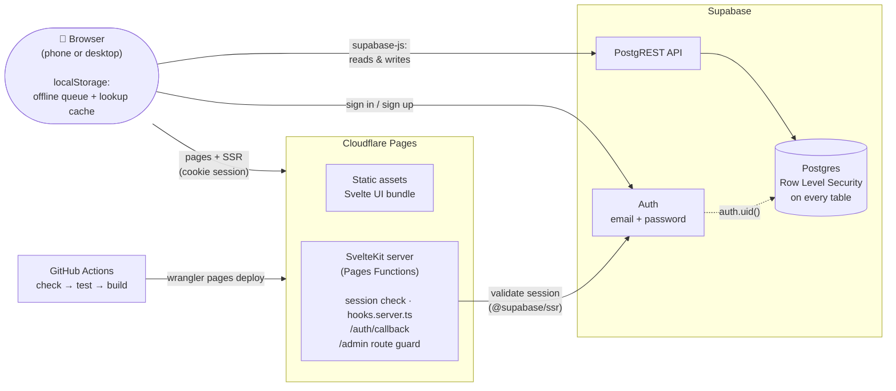
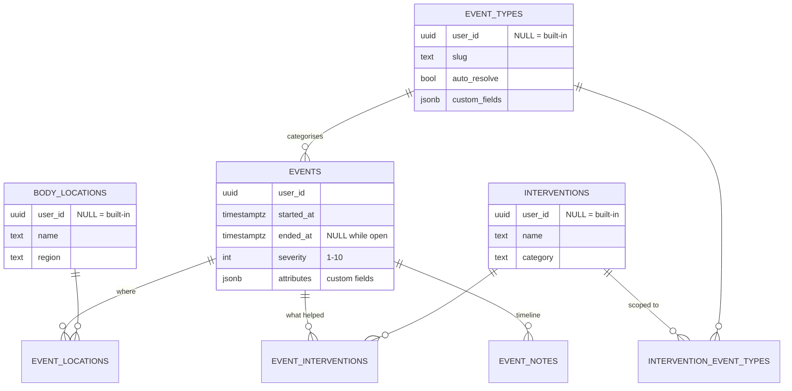

# MS Event Tracker

**Log a muscle spasm in five seconds. Fill in the details later.**

A privacy-focused web app for people living with Multiple Sclerosis to record symptoms as they happen (spasms, pain, bowel movements, panic attacks, anxiety, intrusive thoughts), note what helped, and hand a clean history to their care team.


---

## Why

When a spasm or panic attack hits, nobody wants to fill in a form. Most health trackers ask for everything up front; this one splits logging into two moments:

1. **In the moment**: tap the event type, set severity, optionally tap where it hurts. Done.
2. **Afterwards**: add interventions (baclofen, stretching, a breathing exercise, cannabis…), notes, and mark the episode resolved so its duration is recorded.

Over weeks, that becomes a timeline you can filter, search, and export as CSV or PDF for a neurologist appointment.

## Features

| | |
|---|---|
| **Quick log** | One-screen capture with a 1–10 severity slider and tappable body locations. Built for a phone, one-handed. |
| **Physical & mental-health events** | Muscle spasm, pain episode, bowel movement, panic attack, anxiety, intrusive thought, plus your own custom types with custom fields. |
| **Context-aware interventions** | The picker shows interventions relevant to the event type (grounding and breathing for panic, stretching for spasms), with universal items like rest and medications always available. |
| **Resolve later** | Open episodes stay on the home screen until you add what helped and mark them resolved. Point-in-time types like bowel movements resolve automatically. |
| **Timeline & notes** | Per-event timeline of interventions and free-text notes. |
| **History** | Filter by event type, date range and severity; search; paginate. |
| **Export** | CSV for spreadsheets, PDF summary report for providers. |
| **Customisable** | Admin screens for your own event types, body locations and interventions, and for scoping interventions to event types. |
| **Offline queue** | Quick logs made without a connection are queued locally and synced when you're back online. |
| **Private by design** | Row Level Security on every table, no analytics shipped, self-hostable on free tiers. |

## Architecture



**How it fits together**

- **The browser talks to Supabase directly** using `supabase-js` and the public anon key. There's no custom API layer: authorization is enforced inside Postgres by Row Level Security keyed on `auth.uid()`, so a signed-in user can only ever read or write their own events.
- **The SvelteKit server** runs as Cloudflare Pages Functions (`@sveltejs/adapter-cloudflare`) and manages cookie-based sessions with `@supabase/ssr`. Every request re-validates the user with `getUser()` in `hooks.server.ts`, and a server-side guard protects `/admin`.
- **Offline:** quick logs made without a connection go into a `localStorage` queue and replay when the browser comes back online. Event types, locations and interventions are cached locally for fast startup.
- **Deploys:** pushes to `main` run type checking, tests and a production build in GitHub Actions, then ship with `wrangler pages deploy`.

### Data model



Event types, body locations and interventions with a `NULL` `user_id` are built-in defaults visible to everyone; rows with a `user_id` are that user's own additions. See [Database Schema](docs/development/database-schema.md) for the full design and RLS policies.

## Quick start (local)

Prerequisites: [Devbox](https://www.jetify.com/devbox) (provides Node 24, the Supabase CLI and Wrangler) and Docker.

```bash
git clone https://github.com/johnstetter/my-ms-event-tracker.git
cd my-ms-event-tracker
devbox shell

npm install
supabase start                      # local Postgres, Auth and Studio; applies migrations + seed
cp .env.local.example .env.local    # point the app at the local stack
npm run dev
```

Open **http://localhost:5273** and sign in with the seeded dev account:

```
email:    dev@local.test
password: devpassword
```

| Local service | URL |
|---|---|
| App (Vite) | http://localhost:5273 |
| Supabase API | http://127.0.0.1:54421 |
| Supabase Studio | http://127.0.0.1:54423 |
| Inbucket (auth emails) | http://127.0.0.1:54424 |

Local ports are shifted +100 from the Supabase defaults so this stack can run alongside another local Supabase project. `supabase db reset` rebuilds the database from migrations and re-seeds it.

## Deploy your own

Everything runs on free tiers.

1. **Supabase:** create a project, then apply the schema:
   ```bash
   supabase link --project-ref <your-project-ref>
   supabase db push
   ```
   For a personal instance, consider disabling new sign-ups (*Authentication → Providers → Email*) once your own account exists.
2. **Cloudflare Pages:** create a Pages project named `my-ms-event-tracker`, or change `--project-name` in `.github/workflows/deploy.yml`.
3. **GitHub Actions secrets:** add `PUBLIC_SUPABASE_URL`, `PUBLIC_SUPABASE_ANON_KEY`, `CLOUDFLARE_API_TOKEN` and `CLOUDFLARE_ACCOUNT_ID`.
4. **Push to `main`:** the workflow tests, builds and deploys.

Details: [Cloudflare Pages deployment](docs/deployment/cloudflare-pages.md) · [Environment variables](docs/deployment/environment-variables.md)

## Privacy & security

- **Your data, your instance.** Each deployment uses its own Supabase project; nothing is sent anywhere else.
- **Row Level Security** on every table, so isolation is enforced by the database, not just the UI.
- **Server-validated sessions:** cookies are re-checked with Supabase on every request.
- **No analytics** ship by default, and logs redact sensitive fields.
- **Security headers:** CSP, `frame-ancestors 'none'`, HSTS and more, set in [`hooks.server.ts`](src/hooks.server.ts) for pages and [`_headers`](_headers) for static assets.
- **Export any time:** your full history as CSV or PDF.

This is a personal self-tracking tool. It is not a medical device and not a HIPAA-covered service.

## Commands

```bash
npm run dev            # dev server on :5273
npm run check          # svelte-check + TypeScript
npm run test:run       # Vitest, once
npm test               # Vitest, watch mode
npm run test:coverage  # coverage report
npm run build          # production build (Cloudflare adapter)
npm run deploy         # build + wrangler pages deploy (manual)
```

## Roadmap

- [x] Quick logging, interventions and resolution workflow
- [x] History with filtering, search and pagination
- [x] CSV and PDF export
- [x] Admin for custom event types, locations and interventions
- [x] Mental-health event types with scoped interventions
- [x] Server-side auth guards and critical-path test coverage
- [ ] Calendar view
- [ ] Pattern analysis and statistics
- [ ] Progressive Web App (installable, richer offline support)
- [ ] Home Assistant voice logging ("log a spasm"); see [API design](docs/development/api-design.md)

## Documentation

| Topic | |
|---|---|
| Using the app | [User Guide](docs/user-guide.md) · [Troubleshooting](docs/troubleshooting.md) |
| Local setup | [Development Environment](docs/setup/development-environment.md) · [OAuth Setup](docs/setup/oauth-setup.md) |
| Internals | [Developer Guide](docs/development/developer-guide.md) · [Database Schema](docs/development/database-schema.md) · [Logging](docs/development/logging.md) |
| Everything | [Docs index](docs/README.md) |

## Contributing

Issues and pull requests are welcome.

1. Open an issue describing the bug or feature.
2. Branch from `main` as `type/<issue>-short-name`, e.g. `feat/12-calendar-view`.
3. Run `npm run check && npm run test:run && npm run build` before pushing.
4. Use [Conventional Commits](https://www.conventionalcommits.org/) and reference the issue in your PR.

Please don't include real health data in issues, screenshots or test fixtures.

## License

[MIT](LICENSE)

---

> **Medical disclaimer:** This application is for personal health tracking only and is not a substitute for professional medical advice, diagnosis or treatment. Always consult your healthcare providers about medical decisions.
